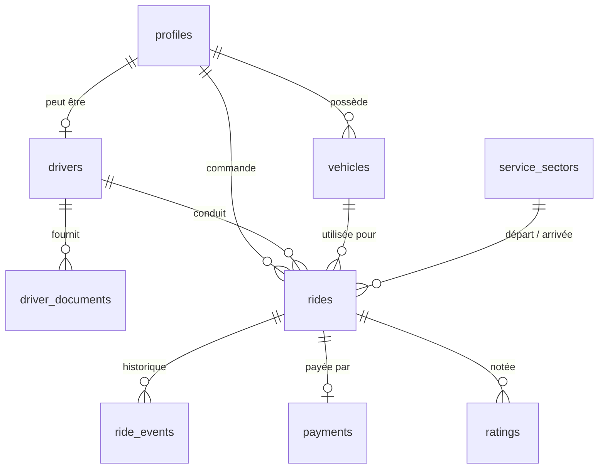

# Base de données — DriveSAF

## Le choix : PostgreSQL + PostGIS, hébergé par Supabase (région Canada)

| Besoin de l'application | Ce qui y répond |
|---|---|
| Données très liées entre elles (clients, voitures, chauffeurs, courses, paiements) | **PostgreSQL**, une base relationnelle (SQL) : clés étrangères, transactions, intégrité garantie. |
| Trouver le chauffeur en ligne **le plus proche** du client | **PostGIS**, l'extension géographique de PostgreSQL (`ST_DWithin`, `ST_Distance`, index spatial). |
| Voir le chauffeur bouger sur la carte **en direct** | **Supabase Realtime** (diffusion des positions sans serveur WebSocket à écrire). |
| Connexion par code SMS | **Supabase Auth**. |
| Photos du permis et documents des chauffeurs | **Supabase Storage** (seau privé). |
| Un client ne doit jamais voir les données d'un autre | **Row Level Security (RLS)** de PostgreSQL. |
| Loi 25 (Québec) et LPRPDE : données personnelles | Projet Supabase dans la région **Canada (Central)**, donc les données restent au Canada. |
| Next.js + TypeScript, comme le portfolio | Client `@supabase/supabase-js` et types TypeScript générés à partir du schéma. |

**Pourquoi pas MongoDB / Firebase ?** Une course touche un client, une voiture, un chauffeur et un paiement en même temps. Le relationnel (SQL) évite les incohérences (une course payée sans chauffeur, par exemple), et PostGIS fait la recherche « chauffeur le plus proche » en une seule requête.

**Pourquoi pas SQL Server ?** Vous le connaissez (TP AdventureWorks), et ça marcherait. Mais il n'existe pas d'offre gratuite avec authentification, temps réel et stockage de fichiers inclus, et l'hébergement coûte plus cher. Votre SQL sert quand même à 95 % : `SELECT`, `JOIN`, clés étrangères et index s'écrivent pareil.

Plus tard, s'il y a beaucoup de chauffeurs : **Redis** pour les positions GPS en direct (très nombreuses écritures), PostgreSQL restant la source de vérité.

## Schéma (version 1)



```sql
create extension if not exists postgis;

-- Utilisateurs (lié au compte Supabase Auth)
create table profiles (
  id            uuid primary key references auth.users on delete cascade,
  full_name     text not null,
  phone         text unique not null,
  role          text not null default 'client' check (role in ('client', 'driver', 'admin')),
  created_at    timestamptz not null default now()
);

create table vehicles (
  id          uuid primary key default gen_random_uuid(),
  owner_id    uuid not null references profiles on delete cascade,
  make_model  text not null,                 -- « Honda Civic »
  plate       text not null,
  gearbox     text not null check (gearbox in ('auto', 'manuelle')),
  province    char(2) not null check (province in ('ON', 'QC'))
);

create table drivers (
  id              uuid primary key references profiles on delete cascade,
  licence_class   text not null check (licence_class in ('G2', 'G', 'QCP', 'QC5')),  -- G2 minimum
  licence_expires date not null,
  status          text not null default 'pending' check (status in ('pending', 'approved', 'suspended')),
  is_online       boolean not null default false,
  location        geography(point, 4326),    -- position GPS actuelle
  rating_avg      numeric(3,2) not null default 5
);
create index drivers_location_idx on drivers using gist (location) where is_online;

create table driver_documents (
  id          uuid primary key default gen_random_uuid(),
  driver_id   uuid not null references drivers on delete cascade,
  kind        text not null check (kind in ('licence_front', 'licence_back', 'driving_record', 'background_check')),
  file_path   text not null,                 -- chemin dans Supabase Storage (privé)
  expires_on  date,
  verified_at timestamptz
);

create table service_sectors (
  id        text primary key,                -- 'byward', 'aylmer'…
  name      text not null,
  province  char(2) not null check (province in ('ON', 'QC')),
  center    geography(point, 4326) not null
);

create table rides (
  id             uuid primary key default gen_random_uuid(),
  client_id      uuid not null references profiles,
  driver_id      uuid references drivers,
  vehicle_id     uuid not null references vehicles,
  status         text not null default 'searching'
                 check (status in ('searching', 'enroute', 'arrived', 'trip', 'dropoff', 'done', 'cancelled')),
  pickup_address text not null,
  pickup_point   geography(point, 4326) not null,
  pickup_sector  text not null references service_sectors,
  dest_address   text not null,
  dest_point     geography(point, 4326) not null,
  dest_sector    text not null references service_sectors,
  fuel_level     numeric(3,2) not null check (fuel_level >= 0.25),   -- minimum 1/4
  reason         text,
  distance_km    numeric(6,2) not null,
  price          numeric(8,2) not null,      -- avant taxes
  tax_amount     numeric(8,2) not null,
  total          numeric(8,2) not null,
  security_pin   char(4) not null,
  created_at     timestamptz not null default now()
);

-- Chaque changement de statut, avec l'heure (preuve en cas de litige)
create table ride_events (
  id         bigint generated always as identity primary key,
  ride_id    uuid not null references rides on delete cascade,
  status     text not null,
  at         timestamptz not null default now(),
  location   geography(point, 4326)
);

create table payments (
  ride_id          uuid primary key references rides,
  stripe_intent_id text unique not null,     -- aucune donnée de carte chez nous
  amount           numeric(8,2) not null,
  driver_payout    numeric(8,2) not null,    -- 80 % du prix avant taxes
  status           text not null check (status in ('authorized', 'captured', 'refunded', 'failed'))
);

create table ratings (
  ride_id   uuid not null references rides on delete cascade,
  author_id uuid not null references profiles,
  stars     smallint not null check (stars between 1 and 5),
  comment   text,
  primary key (ride_id, author_id)
);

-- Sécurité : chaque client ne voit que ses propres courses
alter table rides enable row level security;
create policy "client voit ses courses" on rides
  for select using (auth.uid() = client_id or auth.uid() = driver_id);
```

### Exemple : les 5 chauffeurs en ligne les plus proches du client (dans un rayon de 8 km)

```sql
select d.id, p.full_name,
       round(st_distance(d.location, $1::geography)) as distance_m
from drivers d
join profiles p on p.id = d.id
where d.is_online and d.status = 'approved'
  and st_dwithin(d.location, $1::geography, 8000)
order by d.location <-> $1::geography
limit 5;
```

## Prochaines étapes (tickets du backlog)

- **#2** : créer le projet Supabase en région Canada (Central), activer PostGIS.
- **#3** : transformer ce schéma en migrations dans `supabase/migrations`.
- **#4** : écrire et tester toutes les règles RLS.
